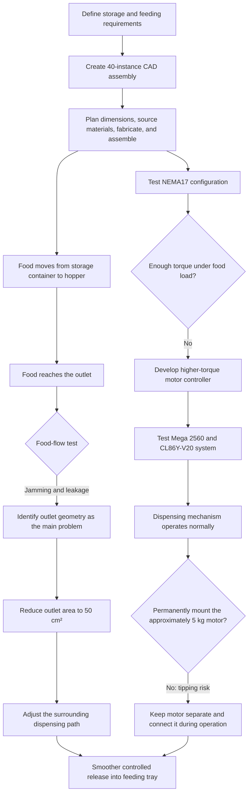

# Automatic Cat Feeder

**[Project Overview](README.md) · [Mechanical Design](docs/mechanical-design.md) · [Motor & Automation](docs/motor-and-automation.md) · [Food Preservation](docs/food-preservation.md)**

This multidisciplinary Alba Studio project combines a modeled and fabricated feeding structure, a motor-driven dispensing system, and a contributor-led food-preservation study. The completed mechanical prototype stores dry cat food and guides it through a controlled outlet into a feeding tray.

The project developed through physical testing rather than ending with its first CAD model. The mechanical system was redesigned after food jammed and leaked around the hopper outlet. The electrical system also progressed through two motor configurations after the original NEMA17 setup proved unable to move the food reliably under load.

## Project Demonstrations

- [Watch the completed feeder prototype](media/automatic_cat_feeder_demo.mp4)
- [Watch the higher-torque motor rotation test](media/high_torque_motor_test.mp4)
- [Download the complete 40-instance STEP assembly](cad/automatic_cat_feeder_assembly.step)

## Design Evolution

| Stage | Design or test | Observation | Resulting decision |
| --- | --- | --- | --- |
| Mechanical concept | A 40-instance assembly modeled the storage container, hopper, guide rails, dispensing mechanism, frame, and feeding tray. | CAD established component relationships but could not predict the full behavior of loose cat food. | Fabricate and test the complete mechanical path. |
| Initial food-flow test | Cat food moved from the hopper toward the original outlet. | Food repeatedly jammed and leaked near the outlet geometry. | Reduce the outlet to 50 cm² and reshape the surrounding dispensing path. |
| Revised food-flow test | The smaller outlet and adjusted path constrained the release. | Food flow became smoother and more controlled. | Retain the revised mechanical design. |
| NEMA17 motor test | Register-level AVR C produced step and direction signals for the original motor configuration. | The controller operated, but the motor did not provide enough torque under the food load. | Develop a second system around a higher-torque motor. |
| Higher-torque motor test | A Mega 2560 controlled a CL86Y-V20 driver with acceleration, deceleration, direction, and serial commands. | The dispensing mechanism could operate normally, but the motor weighed approximately 5 kg. | Keep the motor separate from the main frame to avoid shifting the center of gravity and increasing tipping risk. |

## Development and Operating Flow

## Key Engineering Details

| Item | Value or status |
| --- | --- |
| CAD assembly | 40 instances |
| Revised outlet area | 50 cm² |
| Original motor result | Controller functional; torque insufficient under food load |
| Replacement system | Arduino Mega 2560 + CL86Y-V20 driver + higher-torque motor |
| Driver pulse setting | 1,600 pulses per revolution |
| Large-motor test range | 50–2,000 Hz command limit, equivalent to approximately 1.875–75 RPM at 1,600 pulses/rev |
| Replacement motor mass | Approximately 5 kg |
| Mechanical status | Complete working structure and dispensing path |
| Food-preservation page | Reserved for Wenhao Jia's contributor submission |

## Explore the Project

| Material | Location |
| --- | --- |
| Mechanical design, fabrication, testing, and food-flow redesign | [`docs/mechanical-design.md`](docs/mechanical-design.md) |
| NEMA17 and higher-torque motor iterations | [`docs/motor-and-automation.md`](docs/motor-and-automation.md) |
| Contributor-owned moisture and food-preservation study | [`docs/food-preservation.md`](docs/food-preservation.md) |
| Complete CAD assembly | [`cad/automatic_cat_feeder_assembly.step`](cad/automatic_cat_feeder_assembly.step) |
| NEMA17 source and documentation | [`code/nema17_motor/`](code/nema17_motor/) |
| Higher-torque source, tests, and documentation | [`code/high_torque_motor/`](code/high_torque_motor/) |
| Prototype and motor demonstrations | [`media/`](media/) |

## Contributors

### Shuoqi Yang — Mechanical Engineering Lead

- Created the 40-instance CAD assembly and planned the dimensions and component relationships.
- Sourced and purchased materials, machined and cut parts, and assembled the complete mechanical structure.
- Conducted food-flow testing and documented jamming and leakage around the hopper outlet.
- Identified the outlet geometry as the main mechanical problem, reduced the opening to 50 cm², and redesigned the surrounding path.
- Evaluated how friction, alignment, material behavior, and manufacturing tolerances affected the physical prototype.

### [Shaoxuan Xiong](https://github.com/yuxuan-518) — Electrical Engineering and Automation

- Developed the register-level AVR C motor-control systems for the Arduino Mega 2560.
- Implemented and documented the original dual-NEMA17 test configuration using independent timer-driven step outputs and serial commands.
- Evaluated the NEMA17 setup and identified insufficient torque under the feeder's physical load.
- Developed the higher-torque motor test system around the CL86Y-V20 driver, including acceleration, deceleration, controlled reversal, software stop commands, logging, and a repeatable demonstration sequence.
- Documented the controller's command limits and feedback limitations so commanded pulse frequency would not be presented as measured motor speed or position.

### [Wenhao Jia](https://github.com/jw3422951-ops) — Chemistry and Food Preservation

The detailed chemistry contribution is intentionally left for Wenhao Jia to document in his own Fork and submit through a Pull Request. This repository does not infer or pre-write experimental methods or results on his behalf.
