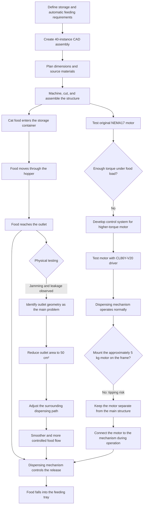

# Automatic Cat Feeder

This project is a functional automatic cat feeder developed by a multidisciplinary team at Alba Studio. The system combines a modeled and fabricated feeding structure, an automated motor-driven dispensing mechanism, and research into moisture protection and food preservation. The completed prototype can store cat food and dispense it through a controlled outlet.

I led the mechanical engineering work. I created a 40-instance CAD assembly covering the food-storage container, hopper, guide rails, dispensing mechanism, supporting frame, and feeding tray. I also planned the dimensions, sourced and purchased materials, machined and cut the parts, assembled the structure, and tested the physical prototype.

Testing revealed recurring food jams and leakage near the hopper outlet. By observing the movement of the food through the mechanism, I identified the outlet geometry as the main source of the problem. I reduced the outlet area to 50 cm² and redesigned the surrounding dispensing path to create a smoother, more controlled flow. This iteration improved reliability and demonstrated how friction, alignment, material behavior, and manufacturing tolerances can cause a physical prototype to behave differently from its CAD model.

The first automated version used a NEMA17 stepper motor. Although its control program operated correctly, physical testing showed that the motor did not provide enough torque to move the cat food reliably. The electrical engineering contributor therefore developed and tested a second control system for a higher-torque motor, allowing the dispensing mechanism to operate normally.

The [higher-torque replacement motor](https://www.amazon.com/dp/B0FVX5SVB4?ref=ppx_yo2ov_dt_b_fed_asin_title&th=1) weighs approximately 5 kg. Permanently mounting it to the feeder could shift the center of gravity and create a tipping risk, so it remains separate from the main frame. When connected, the motor, dispensing mechanism, and feeder structure function together as intended.

[Watch the higher-torque motor rotation test](media/high_torque_motor_test.mp4)

The complete CAD assembly is available as a STEP file: [`cad/automatic_cat_feeder_assembly.step`](cad/automatic_cat_feeder_assembly.step).

The two motor-control iterations are preserved separately:

- [`code/nema17_motor/`](code/nema17_motor/) — the original dual-NEMA17 test project for an Arduino Mega 2560, written in register-level AVR C and configured with PlatformIO.
- [`code/high_torque_motor/`](code/high_torque_motor/) — the higher-torque motor test project for an Arduino Mega 2560 and CL86Y-V20 driver, including acceleration, deceleration, direction control, serial commands, and test code.

[Watch the completed feeder prototype demonstration](media/automatic_cat_feeder_demo.mp4)

## Development and Operating Flow

## Team Contributions

| Area | Contributor | Contribution |
| --- | --- | --- |
| Mechanical Engineering | Shuoqi Yang | Led CAD modeling, dimensional planning, material sourcing and purchasing, machining, fabrication, mechanical assembly, structural testing, and redesign of the dispensing path. |
| Electrical Engineering and Automation | [Shaoxuan Xiong](https://github.com/yuxuan-518) | Developed the motor-control and automation systems, tested the NEMA17 configuration, and implemented the higher-torque replacement motor system. |
| Chemistry and Food Preservation | [Wenhao Jia](https://github.com/jw3422951-ops) | Researched moisture protection and food-preservation methods intended to keep the stored cat food dry and fresh. |
